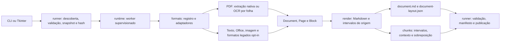

# Traslado — arquitetura e evolução

Atualização de 16/11/2026. Base da 2.0.2 local: commit `c52c5f72f2c8a02cb69136e9698088b1dea343cb`, tag `v2.0.1`. A pasta que originou a revisão contém um pacote histórico 6.0.0rc9. A instalação antiga Freoa 1.1.0 ainda tem seu próprio manifesto. O produto ativo antes desta entrega era Traslado 2.0.1 Full, com Tesseract privado e seis idiomas.

## Arquitetura em produção na série 2.x

- `model.py` concentra opções, páginas e blocos. `detect.py` identifica conteúdo e divergências de extensão. `formats.py` concentra o registro usado pela extração, descoberta e diagnóstico. PDF, OCR e reconstrução avançada têm módulos próprios. MinerU continua experimental e explícito.
- `runner.py` supervisiona trabalho em pasta privada, com limites, resultado tipado, publicação e restauração da saída anterior quando cabível. `runtime.py` e `windows_job.py` gerenciam subprocessos, prazo e contenção de recursos. `document.json` retém blocos brutos. Avisos e `fidelity=unverified` delimitam o que a extração permite inferir.
- `render.py` é a autoridade sobre o texto canônico LF e os intervalos semiabertos em pontos de código Unicode. `chunks.py` usa o mesmo mapa, preserva tabelas, cercas e outras estruturas protegidas, e produz fatias literais em JSONL. O Markdown de cada chunk pode ajustar links relativos gerados pelo conversor.
- `lifecycle.py` e `platform.py` controlam instalação, candidato, promoção, rollback e atalhos. A instalação normal valida origem, hashes, revogação, doctor e fixture. Um build local usa a exceção offline explícita já prevista. A CI do repositório cobre várias versões do Python, plataformas e perfis.
- Consulte [contratos 2.x](CONTRATOS-2.0.md), [contenção](CONTENCAO.md) e [relatório do ciclo de vida](E5-RELATORIO.md). A compatibilidade da Biblioteca depende do Markdown canônico, dos offsets, dos blocos por página e da localização da instalação via `current.json`.

## Avaliação de qualidade

| Achado | Efeito | Decisão |
|---|---|---|
| Chunks varriam todos os átomos, títulos e blocos por segmento | O custo crescia rapidamente com a quantidade de blocos e de chunks | 2.0.2 busca intervalos por posição e avança os títulos uma vez |
| O worker alterava temporariamente a função de renderização do chunker, que ainda repetia renderizações | Dependência implícita e trabalho duplicado, inclusive para entradas com extensão divergente | 2.0.2 passa o mesmo mapa de renderização explicitamente |
| Títulos e blocos recuperados por heurística | Capítulos de PDF, notas, tabelas sem borda e ordem em colunas podem ficar incompletos | Medir com os estratos e casos críticos da 3.0 |
| OCR pode trocar grafia, cifras ou ordinais com confiança alta | A qualidade de reconhecimento depende da folha e do idioma | Validar contra imagem/gabarito, enunciar incerteza e preservar o original |
| Várias árvores locais, releases e logs históricos | Risco de editar ou instalar uma versão superada por engano | Registrar base e estado ativo antes de qualquer build. Manter esta página e o changelog |
| `runner.py`, `chunks.py` e `lifecycle.py` acumulam contratos extensos | Alterações transversais exigem validar produção de artefatos, falhas, cotas e concorrência | Extrair responsabilidades sob testes de identidade, conforme surgirem mudanças |

## Plano por versão

1. **2.0.2 local — desempenho sem mudar o contrato.** Reusar `MarkdownLayout`, indexar intervalos e metadados, medir com documentos sintéticos estruturados, conferir identidade exata de Markdown/JSONL, testar fonte e wheel, empacotar e qualificar candidata Windows Full. Registrar a instalação e como reverter.
2. **3.0 — executar o plano existente.** Fonte local do pré-registro em `C:\Traslado\wt30\int\docs\pre-registro\pre-registro-3.0.md`, ADR em `docs/adr/0001-motor-layout-pymupdf2.md` nessa mesma árvore e contrato em `docs/contratos/projecao-schema1.md`. A avaliação isola extração, chunking e combinação. A fronteira é a projeção `--schema 1` com `classic` para a Biblioteca até promoção por lote. Os gates congelados abrangem identidade, páginas, notas, tabelas, fidelidade por estrato, recall@10, MRR, desempenho, contenção, revogação e rollback. O ramo local `release/3.0` na base apontava para 2.0.1, e a árvore de integração contém o pré-registro. Esses artefatos estabelecem o plano, sem evidência suficiente de execução integral.
3. **Depois da baseline 3.0 — visão por seções.** Medir um índice determinístico de seções/trechos com navegação até offsets e páginas. Testar recuperação com a mesma extração e o mesmo conjunto de consultas. Exigir que exceções, ressalvas, notas e citações continuem recuperáveis no nível da passagem. Se houver benefício, considerar conteúdo derivado em arquivo separado, gerado por opção explícita, com referências verificadas e indicação do método/modelo.

## Decisão sobre o TextFold

O TextFold oferece zoom de leitura em cinco níveis. Mantém o parágrafo integral, seleciona frases no nível breve e gera representações mais curtas com um modelo. A distribuição inclui extração de documentos e leitura web próprias. Ela depende de bibliotecas adicionais e admite provedores externos de modelo. [README do TextFold](https://github.com/chenxiachan/textfold/blob/main/README.md) · [Dependências declaradas](https://github.com/chenxiachan/textfold/blob/main/pyproject.toml).

A ideia aproveitável é passar de uma visão por seções à passagem original. Adotar o pipeline de resumo nos chunks canônicos quebraria a igualdade entre `text` e a fatia de Markdown, além de perder qualificações relevantes para pesquisa jurídica. O 2.0.2 mantém os chunks literais e o processamento local. Um piloto de visualização pode usar os títulos e intervalos já disponíveis, apontar navegação para os hashes de origem e começar sem modelos. Se houver motivo para experimentar resumos, tratar cada derivação como material de navegação, preservar os originais pesquisáveis, usar dados públicos ou modelos locais para conteúdo privado e medir valor antes de incorporar dependência.

## Manutenção deste registro

Em cada entrega, registrar commit base, versão, decisões sobre o esquema, comandos, ambiente, resultados e skips, hash do pacote e estado ativo após o teste instalado. Registrar a revisão da saída com documento público ou sintético e distinguir validação técnica de fidelidade do conteúdo. Manter logs e relatórios de medição junto à release que os produziu.
